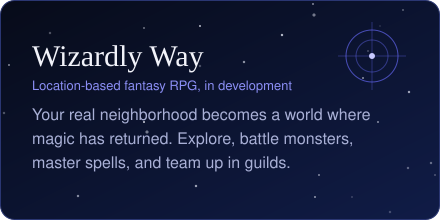
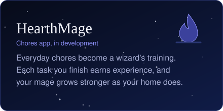

  

### Hi, I'm Sean 👋

I lead engineering teams that build mobile apps and the APIs behind them. I spent 15+ years at UPS, growing from app developer to engineering manager. There I led the rebuild of the customer mobile app, which made startup 50% faster and doubled NPS. In October 2026 I joined **Sinclair** as a Senior Software Engineering Manager.

After hours, I build games where magic meets the real world.

**Full portfolio → [smurray88.github.io](https://smurray88.github.io)**

---

### What I'm building

  
  

### Highlights

- 🏆 **Webby Award, People's Voice Winner (2026):** Best App for Businesses
- 🏆 **CIO 100 Award (2026):** recognized for modernization and business impact
- 👥 Recruited and hired 50+ engineers, and led teams of 8–20 across scrum, vendor, and internal groups
- 🤖 Drove GitHub Copilot and AI-assisted development adoption, raising engineering velocity by 15%

### Tools of the trade

### Get in touch

